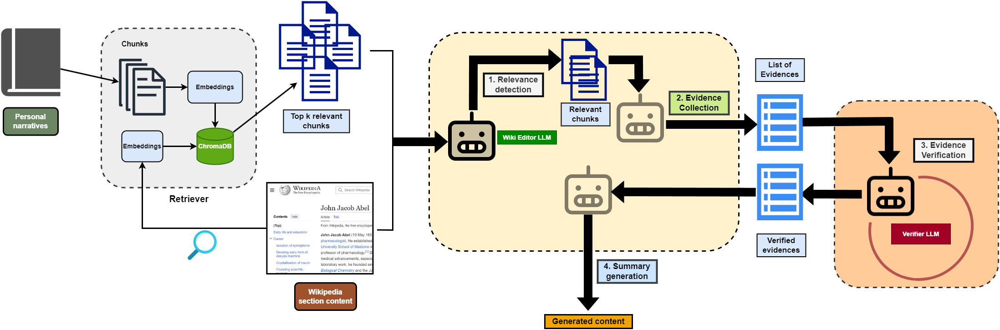

# REVERSUM: Agentic RAG for Enhancing Wikipedia Biographies with Personal Narratives

[](./2025.coling-industry.61.pdf)
[](LICENSE)

This repository contains the official code and dataset for our COLING-Industry Track 2025 paper:  
**"REVERSUM: A Multi-staged Retrieval-Augmented Generation Method to Enhance Wikipedia Tail Biographies through Personal Narratives"** .

---

## 📖 Overview

Wikipedia articles on lesser-known personalities (B and C-class biographies) often lack depth and detail.  
Our approach, **REVERSUM**, introduces an **agentic multi-stage RAG pipeline** that simulates an **LLM-based agent workflow** to enrich these “tail” articles using **personal narratives** (autobiographies & biographies).  

Unlike standard one-shot RAG, REVERSUM **acts like a chain of agents**, each responsible for a specialized role:  

1. **Relevance Detection Agent** – Filters narrative passages most aligned with the section.  
2. **Evidence Collection Agent** – Extracts fine-grained candidate evidences.  
3. **Verification Agent** – Validates that evidences are grounded in source context (no hallucinations).  
4. **Summarization Agent** – Produces coherent, Wikipedia-ready text.  

🔑 **Key Idea:** By breaking down generation into agent-like sub-tasks, REVERSUM reduces redundancy, improves factual grounding, and ensures higher-quality content integration.  

📊 **Performance:** REVERSUM outperforms strong baselines in:  
- **Integrability**: +17% improvement  
- **Informativeness**: +28.5% improvement:contentReference[oaicite:0]{index=0}  

---

## 🔍 Agentic Pipeline Diagram



---


## ⚡ Installation

We build upon [Unsloth](https://github.com/unslothai/unsloth) for efficient inference.  

```bash
git clone https://github.com/sayantan11995/wikipedia_enrichment.git
cd wikipedia_enrichment

# Create environment
conda create -n reversum python=3.10
conda activate reversum

# Install dependencies
pip install -r requirements.txt
```

---

## 🚀 Usage

1. Configure your book path
  ```
  Edit the config.json file to point to the correct book from books/tesseract_OCRed/ or Books_txt/.
  ```

2. Run REVERSUM
  ```
  python REVerSum.py
  ```
3. Results
  ```
  Enhanced sections are saved in results/
  ```

---

## 👥 Authors
* Sayantan Adak
* Pauras Mangesh Meher
* Paramita Das
* Animesh Mukherjee

---

## 📌 Keywords

Wikipedia Enrichment • Agentic LLMs • Retrieval-Augmented Generation • Multi-Agent Systems • Knowledge-grounded Generation • Content Expansion • Digital Libraries • Unsloth

---

## 📝 Paper Reference

If you use this repository, please cite:
```
@inproceedings{adak2025reversum,
  title={REVerSum: A Multi-staged Retrieval-Augmented Generation Method to Enhance Wikipedia Tail Biographies through Personal Narratives},
  author={Adak, Sayantan and Meher, Pauras Mangesh and Das, Paramita and Mukherjee, Animesh},
  booktitle={Proceedings of the 31st International Conference on Computational Linguistics: Industry Track},
  pages={732--750},
  year={2025}
}
```


